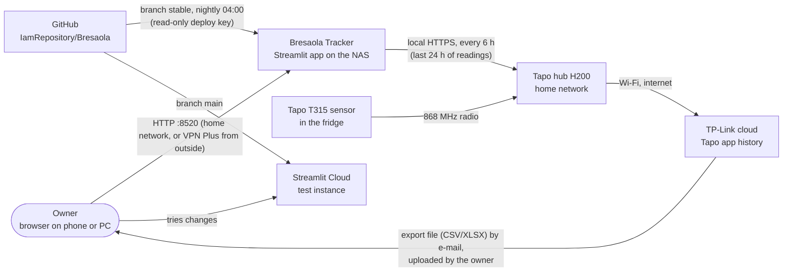
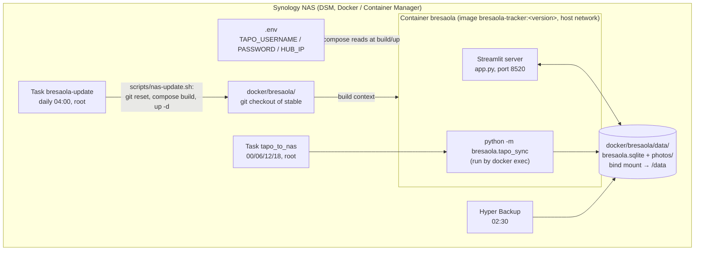
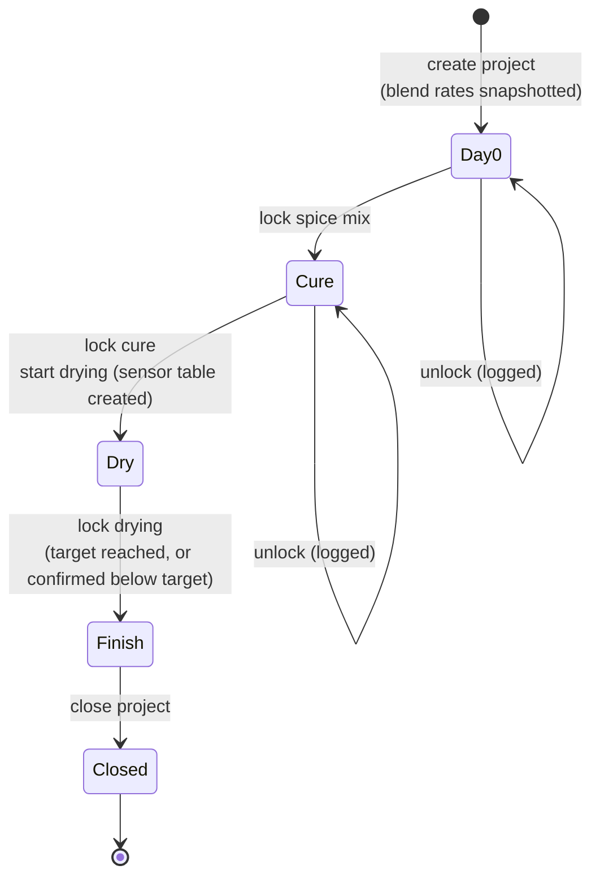
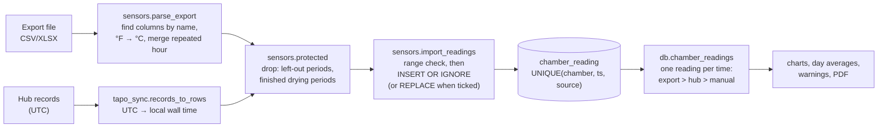
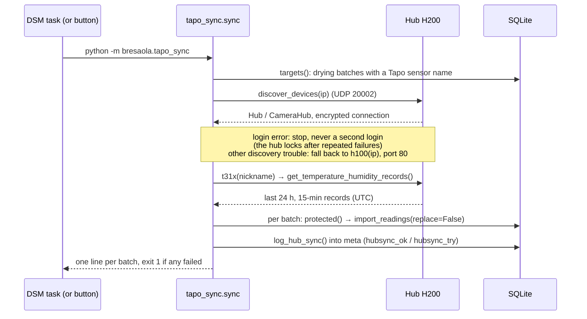
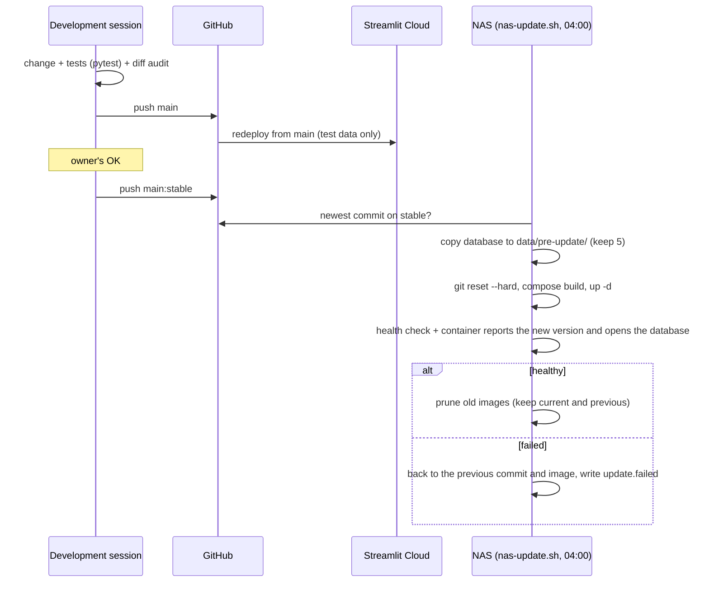
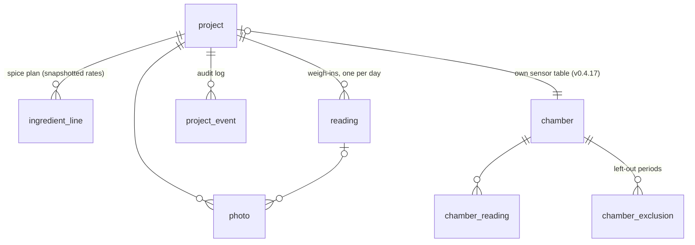

# Bresaola Tracker: architecture

Status: **draft 1, 30 Oct 2026, for review** (v0.4.22). Sections 1–5 are written out; sections 6–9 are an
outline to be filled in once the structure is agreed. Every statement is checked against the code of the
version above. Where the code and this document disagree, the code is right and this document has a bug.

Related documents:

| Document | Purpose |
|---|---|
| `README.md` | What the app is, how to run it locally |
| `docs/ARCHITECTURE.md` | This file: how it is built and why |
| `docs/SETUPS.md` *(planned)* | The three environments in detail: development, test, production |
| `docs/NAS.md` | Production runbook: installing, updating, hub sync, troubleshooting |
| `docs/DECISIONS.md` *(planned)* | Design decisions with date, reason and rejected alternatives |
| `CLAUDE.md` | Working rules for changes: audits, releases, tests |

---

## 1. Purpose and scope

A single-user web app that records home-cured bresaola batches from raw meat to finished product, and turns
the record into decisions: how much salt and spice to weigh out, when the cure is done, when drying has
reached its weight-loss target, and whether the drying conditions stayed inside safe limits.

**In scope**

- Four stages per batch (*project*): Day 0 (spice and bag) → Cure → Dry → Finish. Each stage is locked when
  done; unlocking is explicit and logged.
- Calculation of the spice plan, cure time, weight-loss progress and an estimated finish date.
- Temperature and humidity per batch, from Tapo T310/T315 sensors (file export or the hub on the home
  network), checked against food-safety limits.
- Photos and notes per stage, a PDF report per batch, backup/restore as one zip file.

**Out of scope**

- Several users or roles: there is no login. Access control is the home network only; from outside, the Synology VPN Plus (docs/NAS.md, section 4).
- Controlling the fridge or chamber. The app only reads conditions; it never switches anything.
- Recipes other than the blends in `bresaola/blends.py` (editing blends in the app is in the backlog).

**Quality goals, in order**

1. **The record is trustworthy.** Data is only added, never silently overwritten; finished stages are
   locked; every change to a locked item is logged in `project_event`. The PDF of a finished batch never
   changes afterwards.
2. **Food-safety rules are explicit and in one place** (`bresaola/safety.py`), read by both the app and the PDF.
3. **Operation needs no attention.** The NAS updates itself from a tested branch, rolls back on failure,
   and the sensor readings arrive on their own.
4. **Usable on a phone** in the kitchen or garage (narrow layout, no hover-only controls).

---

## 2. System context

Who and what the app talks to.



Two independent routes bring sensor readings in, and they meet in the same table:

| Route | Source | Trigger | Covers | Limits |
|---|---|---|---|---|
| Export upload | TP-Link cloud, via the Tapo app | Owner, by hand | Whole history | Manual; same gaps as the hub (what the hub never received isn't in the cloud either) |
| Hub sync | The hub, over the LAN | NAS scheduled task every 6 h, or the button | Last 24 h only, nothing from before the hub's last restart | Needs `.env` with Tapo account and hub address |

Gaps in the readings come from the radio link between sensor and hub. Neither route can fill them.

---

## 3. Building blocks

### 3.1 Runtime components



- The **container is disposable.** Every update builds a new image and replaces the container. Everything
  that must survive lives in the bind-mounted `data/` folder, which git ignores.
- The **app and the sync share the database file**, from two processes. SQLite's file locking serialises
  their writes; each write is a short transaction (see 5.4).
- **Credentials are never in git, the image or the database.** `.env` sits next to `compose.yaml` on the NAS
  and is passed in as environment variables (`compose.yaml` maps `${TAPO_*:-}`). It's also listed in
  `.dockerignore`, so `COPY . .` can't bake it into the image.

### 3.2 Code map

All application code is Python. `app.py` is the only module that imports Streamlit; everything in `bresaola/`
can be used and tested without a UI.

| Module | Lines | Responsibility | Depends on |
|---|---:|---|---|
| `app.py` | 1763 | The whole UI: sidebar (projects, backup), step rail, the four step pages, charts, sensor import and sync controls | everything below, Streamlit, Altair, pandas |
| `bresaola/db.py` | 1098 | Schema, migrations, all reads and writes, locking rules, event log, the v0.4.17 conversion | `calc` |
| `bresaola/calc.py` | 235 | Pure calculations: spice plan, cure time, weight loss, progress, finish estimate | `blends` |
| `bresaola/safety.py` | 143 | Food-safety limits and the messages built from them | — |
| `bresaola/sensors.py` | 387 | Parsing Tapo export files, importing readings, left-out periods, gaps, averages | `db` |
| `bresaola/tapo_sync.py` | 247 | Hub sync: discovery, login, fetching, storing, logging; also a command-line entry point | `db`, `sensors`, `tapo` (optional) |
| `bresaola/report.py` | 449 | The PDF report (ReportLab, bundled DejaVu fonts) | `db`, `calc`, `safety`, `sensors` |
| `bresaola/storage.py` | 226 | Where data lives, test/persistent mode, photo files, backup and restore zip | — |
| `bresaola/blends.py` | 43 | The blend table and the salt/EcoCure rates | — |
| `bresaola/stages.py` | 19 | Stage states for the step rail | — |
| `bresaola/demo.py` | 64 | Demo batch and made-up sensor readings for a fresh test database | `db`, `sensors` |
| `bresaola/seed_from_xlsx.py` | 81 | One-off import of the original Excel workbook | `db` |
| `scripts/nas-update.sh` | 136 | Nightly update on the NAS with health check and rollback | git, docker, curl |

Dependency rule: `calc`, `safety`, `blends` and `stages` import nothing from the app or the database, so the
rules that matter most are pure functions with direct unit tests.

### 3.3 Third-party components

| Component | Pin | Used for | Notes |
|---|---|---|---|
| Streamlit | `>=1.65,<1.67` | UI and web server | Pinned on purpose: an upgrade is a full-audit trigger (`CLAUDE.md`) |
| Altair / Vega-Lite | `>=5.0` | Charts | Vega-Lite runs in the browser |
| pandas | `>=2.0` | Chart data frames | |
| ReportLab, pypdf | `>=4.0` | PDF build; pypdf only in tests | |
| Pillow, pillow-heif | | Photos, including iPhone HEIC | |
| openpyxl | | Excel exports from the Tapo app | |
| tapo | `>=0.11,<0.13` | Hub connection (Rust library with Python bindings) | Only on the NAS (`requirements-local.txt`); 0.12.0 in the current image |

---

## 4. Data flows

### 4.1 Batch lifecycle



Locks are timestamps on the project row (`spice_locked_at`, `cure_locked_at`, `dry_locked_at`). Every write
function in `db.py` checks the relevant lock first and raises `Locked`. Ending drying below the weight-loss
target needs an explicit confirmation, which is logged and printed in the PDF.

### 4.2 Sensor readings



Rules that hold on every route:

- **Times are local wall-clock time** (`Europe/Berlin`, `BRESAOLA_TZ`), stored as naive ISO strings. The hub
  reports UTC and is converted on the way in. In the October clock change, the repeated hour is averaged
  rather than overwritten.
- **Add, never overwrite.** An import keeps readings already stored for a time unless the owner ticks
  *Replace readings that are already there*. The hub sync never replaces anything.
- **Left-out periods** (`chamber_exclusion`) are applied to every later import and sync, not just the import
  where they were entered.
- **Finished drying periods are frozen.** Readings inside a locked drying period are neither added nor
  removed, so the PDF of a finished batch stays reproducible.
- **One reading per time on read.** The same quarter-hour can exist from the export and from the hub (unique
  key includes `source`, so each stays removable on its own). `chamber_readings` returns one per time, by
  the rank in `SOURCE_RANK`.

### 4.3 Hub sync, step by step



One sensor can serve several batches (the owner's Palermo and Rome share "Fridge, garage"): it's fetched
once and stored into each batch's table separately.

### 4.4 Release and update



The image tag equals the app version (`compose.yaml`, enforced by `tests/test_deploy.py`), because Container
Manager reuses an image whose name it already has.

---

## 5. Data model

### 5.1 Tables



| Table | Key columns | Notes |
|---|---|---|
| `project` | `id`, `name` (unique), `status` active/closed | One row per batch, all stage fields and lock timestamps. `tare_g` and `target_loss_pct` are per batch. |
| `ingredient_line` | `(project_id, position)` unique | Planned amounts from the blend at creation time; `actual` and `note` as weighed. |
| `reading` | `(project_id, day)` unique | Gross weights (meat + wrap + net) in grams. |
| `photo` | `path` relative to the photo folder | `stage` ties it to a step page. Files under `data/photos/<project>/`. |
| `project_event` | `ts`, `kind`, `detail` | Append-only log: locks, unlocks, target changes, below-target confirmations… |
| `chamber` | `id`, `name` (unique) | Since v0.4.17 one per batch: `project_id` is the owner, `kind` fridge/chamber sets the limits, `tapo_name` is the sensor name for the hub sync. |
| `chamber_reading` | `(chamber_id, ts, source)` unique | `source`: `tapo_export`, `tapo_api` or `manual`. |
| `chamber_exclusion` | `(chamber_id, start_ts, end_ts)` unique | Left-out periods, inclusive both ends. |
| `meta` | `key` | Small settings: `last_project_id` (ids are never reused), `hubsync_ok:<chamber>`, `hubsync_try:<chamber>` (JSON). |

### 5.2 Schema changes and migrations

- `SCHEMA` in `db.py` uses `CREATE TABLE IF NOT EXISTS`; new columns are added by `MIGRATIONS`
  (`ALTER TABLE … ADD COLUMN`) every time a connection opens. Opening an old database or an old backup
  therefore upgrades it in place.
- One-off data conversions run in `connect()` too and must be idempotent. Example: `_split_shared_chambers`
  (v0.4.17) gives each batch its own sensor table. It makes a safety copy of the database file first, skips
  the conversion if the copy fails, and runs under `BEGIN IMMEDIATE` so two processes can't convert at once.
- A schema or migration change is a full-audit trigger (`CLAUDE.md`, trigger 2).

### 5.3 Files

```
docker/bresaola/data/
├── bresaola.sqlite                          the database
├── photos/<project id>/…                    photo files
├── pre-update/bresaola-<stamp>.sqlite       copy before each update (last 5)
├── pre-update/compose-<stamp>.yaml
├── before-restore/…                         copy before an in-app restore
└── bresaola-before-v0.4.17-<stamp>.sqlite   copy before the v0.4.17 conversion
```

### 5.4 Concurrency

Two writers can be active: the Streamlit process (one rerun per click, per browser tab) and the sync process.
Both use short transactions and Python's default 5 s busy timeout. Known limits, accepted:

- A stale browser tab can't write its old widget values back: widget keys include a hash of the database
  value (`fresh()` in `app.py`, full audit 28 Oct 2026, #1).
- If the sync log can't be written because the database is busy, the readings are kept and only the log
  entry is skipped.

---

## 6. Cross-cutting concepts *(outline)*

- 6.1 Locking and the event log: which actions lock, which unlock, what is logged.
- 6.2 Food-safety logic: limits in `safety.py`, where each limit is checked (app, PDF, charts), fridge vs
  curing chamber, curing salt (EcoCure #2) and what changes without it.
- 6.3 Time handling: local wall time, the weigh-in time of 12:00, clock changes, the hub's UTC.
- 6.4 UI state in Streamlit: reruns, session state, widget keys, the stale-tab rule, the sticky step rail,
  phone layout.
- 6.5 Text escaping: user text shown as typed in Markdown and HTML (`md()`, `blk()`), never interpreted.
- 6.6 Test and persistent mode: `BRESAOLA_MODE`, the demo data, what Streamlit Cloud can't do.
- 6.7 Errors and messages: flash messages after reruns, warnings vs info, what the scheduled tasks e-mail.

## 7. Quality assurance *(outline)*

- 7.1 Test suite: about 300 pytest tests; unit tests for the pure modules, `AppTest` for the UI, fake hub
  and fake Docker for the sync and the update script.
- 7.2 The rule "every bug fix gets a test that fails before the fix", and how that's checked.
- 7.3 Diff audits and full audits: scope, triggers, what each found so far (summary of `CLAUDE.md`).
- 7.4 Browser checks with Playwright at 1280 and 390 px.

## 8. Risks and technical debt *(outline)*

- Sensor gaps (radio link), hub firmware changes (port 80 closed on 1.7.7), the `tapo` library pin.
- `app.py` at about 1800 lines: candidates for splitting.
- Single point of storage: the NAS; restore tested on 26 Oct 2026.
- Streamlit upgrade path.

## 9. Glossary *(outline)*

Batch / project, chamber, left-out period, tare, gross weight, target loss, EcoCure #2, stable branch,
diff audit, full audit.
