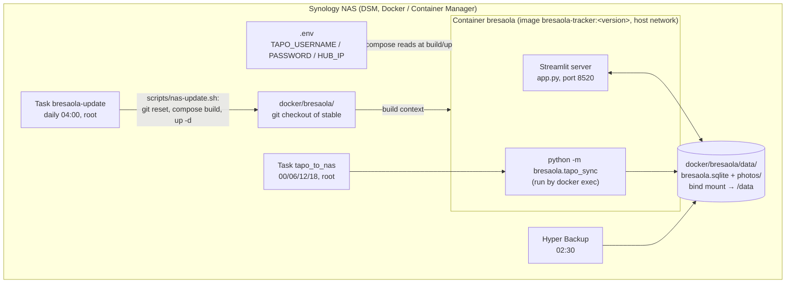
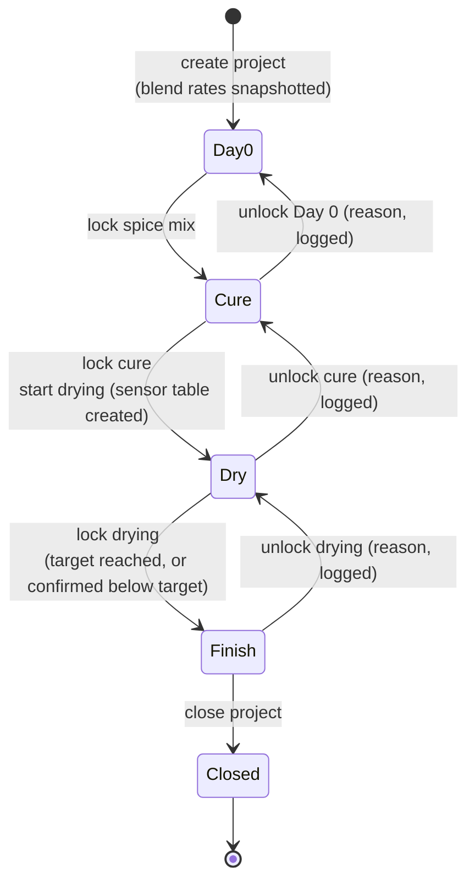
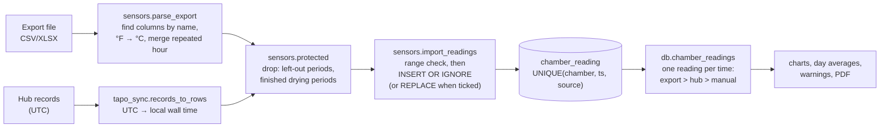
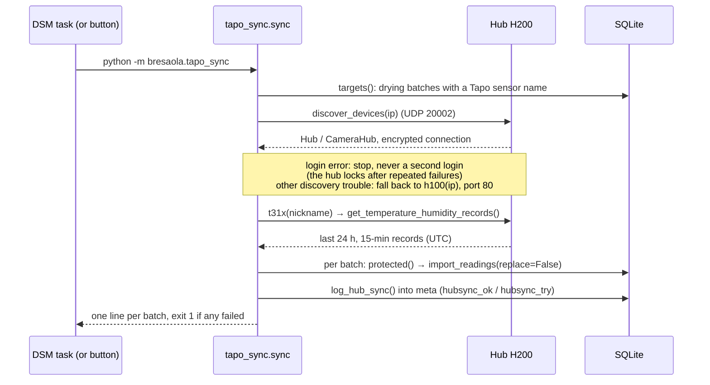
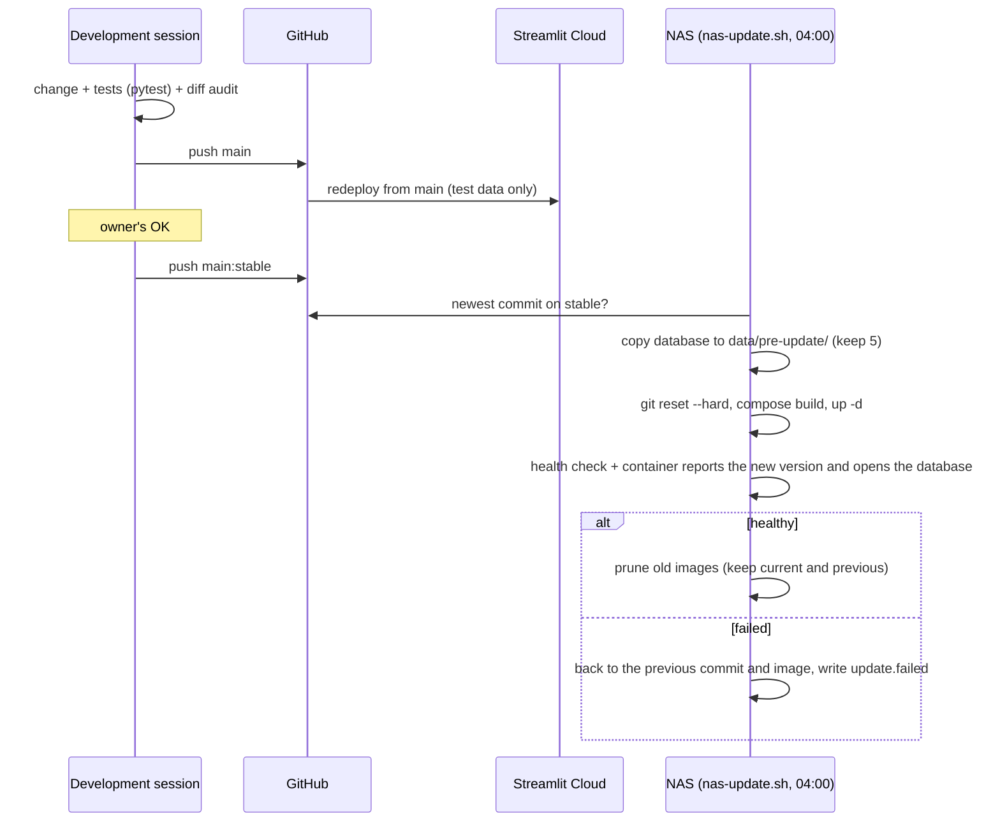
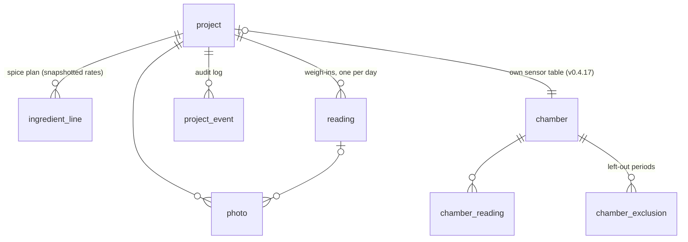

# Bresaola Tracker: architecture

Status: **draft 2, 30 Oct 2026** (v0.4.22). Every statement, constant and formula is checked against the code
of that version. Where the code and this document disagree, the code is right and this document has a bug:
fix it in the same change set (`CLAUDE.md`).

Related documents:

| Document | Purpose |
|---|---|
| `README.md` | What the app is, how to run it locally |
| `docs/ARCHITECTURE.md` | This file: how it is built and why |
| `docs/SETUPS.md` | The three environments in detail: development, test, production |
| `docs/NAS.md` | Production runbook: installing, updating, hub sync, troubleshooting |
| `docs/DECISIONS.md` | Design decisions with date, reason and rejected alternatives |
| `CLAUDE.md` | Working rules for changes: audits, releases, tests |

---

## 1. Purpose and scope

A single-user web app that records home-cured bresaola batches from raw meat to finished product, and turns
the record into decisions: how much salt and spice to weigh out, when the cure is done, when drying has
reached its weight-loss target, and whether the drying conditions stayed inside safe limits.

**In scope**

- Four stages per batch (*project*): Day 0 (spice and bag) → Cure → Dry → Finish. Each stage is locked when
  done; unlocking is explicit and logged.
- Calculation of the spice plan, cure time, weight-loss progress and an estimated finish date.
- Temperature and humidity per batch, from Tapo T310/T315 sensors (file export or the hub on the home
  network), checked against food-safety limits.
- Photos and notes per stage, a PDF report per batch, backup/restore as one zip file.

**Out of scope**

- Several users or roles: there is no login. Access control is the home network only; from outside, the Synology VPN Plus (docs/NAS.md, section 4).
- Controlling the fridge or chamber. The app only reads conditions; it never switches anything.
- Recipes other than the blends in `bresaola/blends.py` (editing blends in the app is in the backlog).

**Quality goals, in order**

1. **The record is trustworthy.** Data is only added, never silently overwritten; finished stages are
   locked; every change to a locked item is logged in `project_event`. The PDF of a finished batch never
   changes afterwards.
2. **Food-safety rules are explicit and in one place** (`bresaola/safety.py`), read by both the app and the PDF.
3. **Operation needs no attention.** The NAS updates itself from a tested branch, rolls back on failure,
   and the sensor readings arrive on their own.
4. **Usable on a phone** in the kitchen or garage (narrow layout, no hover-only controls).

---

## 2. System context

Who and what the app talks to.


Two independent routes bring sensor readings in, and they meet in the same table:

| Route | Source | Trigger | Covers | Limits |
|---|---|---|---|---|
| Export upload | TP-Link cloud, via the Tapo app | Owner, by hand | Whole history | Manual; same gaps as the hub (what the hub never received isn't in the cloud either) |
| Hub sync | The hub, over the LAN | NAS scheduled task every 6 h, or the button | Last 24 h only, nothing from before the hub's last restart | Needs `.env` with Tapo account and hub address |

Gaps in the readings come from the radio link between sensor and hub. Neither route can fill them.

---

## 3. Building blocks

### 3.1 Runtime components



- The **container is disposable.** Every update builds a new image and replaces the container. Everything
  that must survive lives in the bind-mounted `data/` folder, which git ignores.
- The **app and the sync share the database file**, from two processes. SQLite's file locking serialises
  their writes; each write is a short transaction (see 5.4).
- **Credentials are never in git, the image or the database.** `.env` sits next to `compose.yaml` on the NAS
  and is passed in as environment variables (`compose.yaml` maps `${TAPO_*:-}`). It's also listed in
  `.dockerignore`, so `COPY . .` can't bake it into the image.

### 3.2 Code map

All application code is Python. `app.py` is the only module that imports Streamlit; everything in `bresaola/`
can be used and tested without a UI.

| Module | Lines | Responsibility | Depends on |
|---|---:|---|---|
| `app.py` | 1763 | The whole UI: sidebar (projects, backup), step rail, the four step pages, charts, sensor import and sync controls | everything below, Streamlit, Altair, pandas |
| `bresaola/db.py` | 1098 | Schema, migrations, all reads and writes, locking rules, event log, the v0.4.17 conversion | `calc`; `safety` (lazy imports) |
| `bresaola/calc.py` | 235 | Pure calculations: spice plan, cure time, weight loss, progress, finish estimate | `blends` |
| `bresaola/safety.py` | 143 | Food-safety limits and the messages built from them | `sensors` (lazy import, for hourly averages) |
| `bresaola/sensors.py` | 387 | Parsing Tapo export files, importing readings, left-out periods, gaps, averages | `db` |
| `bresaola/tapo_sync.py` | 247 | Hub sync: discovery, login, fetching, storing, logging; also a command-line entry point | `db`, `sensors`, `tapo` (optional) |
| `bresaola/report.py` | 449 | The PDF report (ReportLab, bundled DejaVu fonts) | `db`, `calc`, `safety`, `sensors` |
| `bresaola/storage.py` | 226 | Where data lives, test/persistent mode, photo files, backup and restore zip | — |
| `bresaola/blends.py` | 43 | The blend table and the salt/EcoCure rates | — |
| `bresaola/stages.py` | 19 | Stage states for the step rail | — |
| `bresaola/demo.py` | 64 | Demo batch and made-up sensor readings for a fresh test database | `db`, `sensors` |
| `bresaola/seed_from_xlsx.py` | 81 | One-off import of the original Excel workbook | `db` |
| `scripts/nas-update.sh` | 136 | Nightly update on the NAS with health check and rollback | git, docker, curl |

Dependency rule: `calc`, `blends` and `stages` import nothing from the app or the database, so the
calculations are pure functions with direct unit tests. `safety` holds pure limits and message builders,
but two checks average sensor rows through `sensors` (imported inside the function, because `db` imports
`safety` the same way); its tests pass plain rows and need no database.

### 3.3 Third-party components

| Component | Pin | Used for | Notes |
|---|---|---|---|
| Streamlit | `>=1.65,<1.67` | UI and web server | Pinned on purpose: an upgrade is a full-audit trigger (`CLAUDE.md`) |
| Altair / Vega-Lite | `>=5.0` | Charts | Vega-Lite runs in the browser |
| pandas | `>=2.0` | Chart data frames | |
| ReportLab, pypdf | `>=4.0` | PDF build; pypdf only in tests | |
| Pillow, pillow-heif | | Photos, including iPhone HEIC | |
| openpyxl | | Excel exports from the Tapo app | |
| tapo | `>=0.11,<0.13` | Hub connection (Rust library with Python bindings) | Only on the NAS (`requirements-local.txt`); 0.12.0 in the current image |

---

## 4. Data flows

### 4.1 Batch lifecycle



Locks are timestamps on the project row (`spice_locked_at`, `cure_locked_at`, `dry_locked_at`). The functions
that change a stage's inputs check its lock first (`_require_unlocked`) and raise `Locked`; unlocking goes in
reverse order (8.1). Ending drying below the weight-loss
target needs an explicit confirmation, which is logged and printed in the PDF.

### 4.2 Sensor readings



Rules that hold on every route:

- **Times are local wall-clock time** (`Europe/Berlin`, `BRESAOLA_TZ`), stored as naive ISO strings. The hub
  reports UTC and is converted on the way in. In the October clock change, the repeated hour is averaged
  rather than overwritten.
- **Add, never overwrite.** An import keeps readings already stored for a time unless the owner ticks
  *Replace readings that are already there*. The hub sync never replaces anything.
- **Left-out periods** (`chamber_exclusion`) are applied to every later import and sync, not just the import
  where they were entered.
- **Finished drying periods are frozen.** Readings inside a locked drying period are neither added nor
  removed, so the PDF of a finished batch stays reproducible.
- **One reading per time on read.** The same quarter-hour can exist from the export and from the hub (unique
  key includes `source`, so each stays removable on its own). `chamber_readings` returns one per time, by
  the rank in `SOURCE_RANK`.

### 4.3 Hub sync, step by step



One sensor can serve several batches (the owner's Palermo and Rome share "Fridge, garage"): it's fetched
once and stored into each batch's table separately.

### 4.4 Release and update



The image tag equals the app version (`compose.yaml`, enforced by `tests/test_deploy.py`), because Container
Manager reuses an image whose name it already has.

---

## 5. Data model

### 5.1 Tables



Conventions for every table: dates are ISO `YYYY-MM-DD` text, timestamps ISO `YYYY-MM-DDTHH:MM:SS` text in
local wall-clock time (see 8.3); booleans are `INTEGER` 0/1; weights are grams; `PRAGMA foreign_keys = ON`
is set on every connection, so the `ON DELETE CASCADE` clauses below are enforced.

#### `project`: one row per batch

| Column | Type | Set by | Meaning |
|---|---|---|---|
| `id` | INTEGER PK | create | Never reused: the highest id ever issued is kept in `meta.last_project_id`, so a deleted batch's photo folder can't be inherited. |
| `name` | TEXT unique | create, rename | Name without the date; the UI shows `display_name()`: `YY/MM/DD <name>` from `start_date`. |
| `status` | TEXT | close | `active` or `closed` (CHECK). Closed = read-only everywhere. |
| `created_at` | TEXT ts | create | When the row was created. |
| `start_date` | TEXT date | create, project menu | Day 0: meat trimmed, spiced and bagged. Can't be in the future. |
| `closed_at` | TEXT ts | close | |
| `blend` | TEXT | Day 0 | Name of the blend in `blends.BLENDS`; its rates are copied into `ingredient_line` (snapshot). |
| `ecocure` | INTEGER 0/1 | Day 0 | Curing salt EcoCure #2 used. Switching it off needs a confirmation; every change is logged (`curing_salt_changed`). |
| `green_weight_g` | REAL | Day 0 | Raw meat weight after trimming, W in section 6. |
| `spice_locked_at` | TEXT ts | lock Day 0 | Lock 1. NULL = editable. |
| `spice_note` | TEXT | Day 0 | Free text, stays editable after the lock. |
| `shape` | TEXT | Cure | `flat` or `tubular` (CHECK); selects the cure-time formula. |
| `thickness_cm` | REAL | Cure | d in section 6.2. For an oval piece: the widest side. |
| `length_cm` | REAL | Cure | Informational only, not used in a calculation. |
| `thickness_estimated` | INTEGER 0/1 | Cure | Marks d as estimated; shown in the app and the PDF. |
| `cure_method` | TEXT | — | Legacy (v0.2). Folded into `cure_note` on open, then set to NULL. |
| `cure_start` | TEXT date | Cure | Into the bag. Not before `start_date`, not in the future. |
| `cure_end_planned` | TEXT date | Cure (computed) | `cure_start + t_plan` (6.2), recomputed on every save of the cure. |
| `cure_end_actual` | TEXT date | Cure | Out of the bag. Required before the cure can be locked; not after `dry_start`. |
| `cure_note` | TEXT | Cure | |
| `cure_locked_at` | TEXT ts | lock Cure | Lock 2. |
| `cure_fridge_c` | REAL | Cure | Optional temperature of the cure fridge, −5…30 °C (migration). Above 4 °C: warning (7.2, 7.6). |
| `chamber_id` | INTEGER FK → `chamber` | start drying | The batch's own sensor table (4.2, 5.2). |
| `dry_start` | TEXT date | start drying | Not before `cure_end_actual`, not in the future. |
| `dry_start_gross_g` | REAL | start drying | G₀: gross weight (meat + wrap + net) at the start; also stored as the first row in `reading`. |
| `tare_g` | REAL | drying settings | T: wrap + net weight. Default 0 (owner's choice: loss % then slightly understated, grams exact). |
| `tare_estimated` | INTEGER 0/1 | drying settings | |
| `target_loss_pct` | REAL | drying settings | L*: target weight loss, 25…50 % (enforced), default 35. Changes are logged (`target_changed`). |
| `dry_end` | TEXT date | lock Dry | Not before the last weigh-in, not in the future. |
| `dry_note` | TEXT | Dry | Stays editable after the lock. |
| `dry_locked_at` | TEXT ts | lock Dry | Lock 3. |
| `dry_kind` | TEXT | lock Dry | `fridge`/`chamber` frozen at the lock (migration), so a later change of the chamber's type can't rewrite a finished batch's rules. |
| `equalise_*` | | — | Optional fourth stage (vacuum equalising): database code and tests exist, no screen (backlog). Only counted by `close_problems` when `BRESAOLA_EQUALISE=1`. |
| `final_notes` | TEXT | close | |

#### Other tables

| Table · column | Type | Meaning |
|---|---|---|
| `ingredient_line.project_id`, `position` | INTEGER, unique pair | Order of the lines: EcoCure (if used), salt, then the blend's lines. |
| `ingredient_line.name` | TEXT | As in the blend at creation time. |
| `ingredient_line.unit` | TEXT | `pct` (grams, a fraction of W) or `per_kg` (pieces per kg). |
| `ingredient_line.rate` | REAL | The snapshotted rate r. Editing `blends.py` never changes an existing batch. |
| `ingredient_line.planned` | REAL | q from 6.1 (grams or pieces). |
| `ingredient_line.actual`, `note` | REAL, TEXT | As weighed. Starts equal to `planned` when the plan is written; NULL only if cleared. |
| `reading.day` | TEXT date, unique per batch | One weigh-in per day; saving a second one on the same day replaces it (after a confirmation). |
| `reading.gross_g` | REAL | G: gross weight on the scale. |
| `reading.note` | TEXT | Shown as a numbered footnote under the weigh-in table. |
| `photo.path` | TEXT | Relative to the photo folder; validated against a pattern on restore, so a backup can't point outside it. |
| `photo.stage` | TEXT | `spice`/`cure`/`dry`/`equalise`; NULL = other. Selects the step page. |
| `photo.reading_id` | INTEGER FK, SET NULL | Legacy link to a weigh-in (the weigh-in photo field was removed in v0.4.16). |
| `photo.taken_at`, `caption` | TEXT | |
| `project_event.ts`, `kind`, `detail` | TEXT | Append-only log, kinds: `created`, `renamed`, `start_date_changed`, `blend_changed`, `curing_salt_changed`, `spice_locked`, `spice_unlocked`, `cure_locked`, `cure_unlocked`, `dry_start_changed`, `target_changed`, `dry_locked`, `dry_unlocked`, `equalise_locked`, `equalise_unlocked`, `photo_deleted`, `closed`. |
| `chamber.name` | TEXT unique | Internal name, e.g. "Fridge drawer" or "Rome Classic sensor". |
| `chamber.sensor`, `notes` | TEXT | Informational. |
| `chamber.kind` | TEXT | `fridge` or `chamber`; selects the limits in 7.2. NULL is set to `fridge` on open. |
| `chamber.project_id` | INTEGER | The batch that owns this table (v0.4.17). |
| `chamber.tapo_name` | TEXT | Sensor name in the Tapo app; the hub sync looks it up. Several batches may share one name (one physical sensor). |
| `chamber_reading.ts` | TEXT ts | Local wall-clock time, on the 15-minute grid for Tapo data. |
| `chamber_reading.temp_c`, `rh_pct` | REAL | Rejected on import outside −5…30 °C and 0…100 % (`db.TEMP_RANGE`, `RH_RANGE`). |
| `chamber_reading.source` | TEXT | `tapo_export`, `tapo_api` (hub) or `manual`; part of the unique key. |
| `chamber_exclusion.start_ts`, `end_ts` | TEXT ts | Left-out period, inclusive at both ends. |
| `meta.key`, `value` | TEXT | `last_project_id`; `hubsync_ok:<chamber id>` and `hubsync_try:<chamber id>` as JSON `{at, stored, error, last}`. |

### 5.2 Schema changes and migrations

- `SCHEMA` in `db.py` uses `CREATE TABLE IF NOT EXISTS`; new columns are added by `MIGRATIONS`
  (`ALTER TABLE … ADD COLUMN`) every time a connection opens. Opening an old database or an old backup
  therefore upgrades it in place.
- One-off data conversions run in `connect()` too and must be idempotent. Example: `_split_shared_chambers`
  (v0.4.17) gives each batch its own sensor table. It makes a safety copy of the database file first, skips
  the conversion if the copy fails, and runs under `BEGIN IMMEDIATE` so two processes can't convert at once.
- A schema or migration change is a full-audit trigger (`CLAUDE.md`, trigger 2).

### 5.3 Files

```
docker/bresaola/data/
├── bresaola.sqlite                          the database
├── photos/<project id>/…                    photo files
├── pre-update/bresaola-<stamp>.sqlite       copy before each update (last 5)
├── pre-update/compose-<stamp>.yaml
├── before-restore/…                         copy before an in-app restore
└── bresaola-before-v0.4.17-<YYYYmmdd-HHMMSS>-<pid>.sqlite   copy before the v0.4.17 conversion
```

### 5.4 Concurrency

Two writers can be active: the Streamlit process (one rerun per click, per browser tab) and the sync process.
Both use short transactions and Python's default 5 s busy timeout. Known limits, accepted:

- A stale browser tab can't write its old widget values back: widget keys include a hash of the database
  value (`fresh()` in `app.py`, full audit 28 Oct 2026, #1).
- If the sync log can't be written because the database is busy, the readings are kept and only the log
  entry is skipped.

---

## 6. Calculations

All in `bresaola/calc.py`: pure functions, no database, no UI, each pinned by unit tests (`tests/test_calc.py`).
Symbols used below:

| Symbol | Meaning | Stored in |
|---|---|---|
| W | raw meat weight after trimming (g) | `project.green_weight_g` |
| r | rate of an ingredient | `ingredient_line.rate` |
| d | thickness of the piece (cm) | `project.thickness_cm` |
| G₀ | gross weight at the start of drying (g) | `project.dry_start_gross_g` |
| G | gross weight at a weigh-in (g) | `reading.gross_g` |
| T | tare: wrap + net (g) | `project.tare_g` |
| L* | target weight loss (%) | `project.target_loss_pct` |

`⌈x⌉` is the ceiling. In the spice plan and the cure time, x is first rounded to 9 decimals (`_ceil`), so float noise such as
2.0000000001 can't round up to 3.

### 6.1 Spice plan (`spice_plan`)

Constants in `bresaola/blends.py`: EcoCure rate e = 0.01, salt share of EcoCure #2 s = 0.5, total salt rate
σ = 0.03.

$$E = \begin{cases} e\,W & \text{with EcoCure \#2}\\ 0 & \text{without}\end{cases}
\qquad
S = \sigma W - s\,E$$

so the total salt is always σW = 3 % of the meat, whether or not part of it comes from the curing salt.
For each blend line i:

$$q_i = \begin{cases} r_i\,W & \text{unit } \texttt{pct}\ \text{(grams)}\\[2pt]
\left\lceil \dfrac{W}{1000}\, r_i \right\rceil & \text{unit } \texttt{per\_kg}\ \text{(pieces, rounded up)}\end{cases}$$

Order of the lines: EcoCure #2 (if used), salt, then the blend in table order.

**Checks on what was weighed**

- `mix_summary`: shares of W for salt (including s·E), EcoCure, sugar (names containing "sugar" or
  "turbinado") and other seasoning; pieces are ignored. Shown for plan and actual side by side.
- `off_plan`: a line is flagged when |actual − planned| / planned > 0.10.

Example, Spicy Calabrian, W = 2088 g, no EcoCure: S = 62.6 g salt, sugar 20.9 g, fennel 10.4 g,
bay leaf ⌈2.088 · 1⌉ = 3 pieces.

### 6.2 Cure time (`cure_days_minimum`, `cure_days`)

From the genuineideas.com equilibrium-brine calculator (its script: `curetime = 1.25 · inches²`, halved for a
tubular piece). The calculator calls this a minimum and advises adding 20 % to reach the centre:

$$t_\text{min} = 1.25\left(\frac{d}{2.54}\right)^2 \cdot \begin{cases}1 & \text{flat}\\ \tfrac12 & \text{tubular}\end{cases}
\qquad
t_\text{plan} = \lceil 1.2\, t_\text{min} \rceil \ \text{days}$$

Planned end of the cure = `cure_start + t_plan`. The actual length `cure_end_actual − cure_start` is graded
by `safety.cure_length` (see 7.3).

Example, the demo batch, tubular, d = 17 cm: t_min = 1.25 · 6.69² / 2 = 28.0 days, t_plan = ⌈33.6⌉ = 34 days.
The batch was cured 36 days: "ok".

### 6.3 Drying progress

Loss is measured on the meat only (gross minus tare), from the meat at the **start of drying**, not from the
raw weight. That is stricter, because the meat already loses some weight in the bag.

$$G^* = T + (G_0 - T)\left(1 - \frac{L^*}{100}\right)
\qquad
\text{loss} = 100\,\frac{G_0 - G}{G_0 - T}\ \%
\qquad
p = \frac{G_0 - G}{G_0 - G^*}$$

G* is the target gross weight shown on the chart's target line; p is the progress bar (0 = start, 1 = target
reached, capped at 100 % in the display).

Example: G₀ = 2100 g, T = 0, L* = 35 % → G* = 1365 g.

### 6.4 Estimated finish (`recent_eta`, `drying_eta`)

A least-squares line through a set of weigh-ins (the start weight counts as one), with x = days since the
first weigh-in **of that set** (d₀) and y = G:

$$b = \frac{\sum (x_i - \bar x)(y_i - \bar y)}{\sum (x_i - \bar x)^2},\qquad a = \bar y - b\,\bar x,
\qquad x^* = \frac{G^* - a}{b},\qquad \text{date} = d_0 + \lceil x^* \rceil$$

- The date rounds x* up with a plain ceiling (no 9-decimal rounding here).
- No estimate if b ≥ 0 (not losing weight) or fewer than two weigh-ins on different days.
- **Shown as "Estimated finish": the recent pace.** Only the weigh-ins within 21 days of the latest one
  (`RECENT_DAYS`), and at least the last 3 (`RECENT_MIN_POINTS`).
- The line through **all** weigh-ins is shown in the help text for comparison.
- Both are optimistic: drying slows as the meat dries, so a straight line reaches the target too early. The
  help text says so.

### 6.5 Weigh-in plausibility (`db.reading_problems`)

| Condition | Result |
|---|---|
| Date before `dry_start`, in the future, or G ≤ T | Error: not saved |
| Date = `dry_start` | Error: that's the start weight, edited under the drying start |
| A weigh-in exists on that day | Warning: saving replaces it |
| G > 1.02 · G₀ | Warning: heavier than at the start |
| Drop since the previous weigh-in > (0.02 · days + 0.03) · G_prev | Warning: "Typo?" (faster than any realistic drying) |

Warnings need a tick to save anyway. The weigh-in reminder appears 7 days after the last weigh-in
(`WEIGH_EVERY` in `app.py`).

### 6.6 Climate per weigh-in (`sensors.day_averages`, `period_averages`)

The weigh-in table pairs each weigh-in with the conditions behind it:

- **Day** columns: average of all readings on the weigh-in's calendar day. Marked partial (`*`) when the
  readings cover fewer than 12 different clock hours (`FULL_DAY_HOURS`).
- **Since last** columns: average from 12:00 on the previous weigh-in day to 12:00 on this one (weigh-ins
  have a date only and are placed at noon, `WEIGH_IN_TIME`), start inclusive, end exclusive.
- **Data [%]**: coverage = distinct (date, hour) pairs with readings ÷ wall-clock hours in the period. The
  wall-clock count handles the clock changes: 23 or 25 hours on those days. Below 50 %
  (`PERIOD_MIN_COVERAGE`) the period averages are marked partial.

### 6.7 Chart aggregation (`sensors.aggregate`) and gaps (`sensors.gaps`)

- Blocks of 1, 12 or 24 hours, aligned to midnight. Each block has an average, minimum and maximum per
  quantity and the number of readings; it's plotted at its middle (a 24 h block at 12:00, like the weigh-ins).
  Blocks without readings are left out.
- On the chart, a line is broken where the time between two points exceeds 1.5 × the block length (1 h in
  the 15-minute view), so it never bridges missing data.
- A *gap* in the overview is any stretch of at least 6 hours between two readings within the drying
  period (`sensors.gaps`). The overview hides a gap only when a left-out period covers it, to within one
  hour at both ends; a gap that overlaps a left-out period only partly is shown in full. Before the first
  and after the last reading is not a gap.

---

## 7. Food safety

This is the part of the app where a wrong number has consequences outside the app. All limits live in
`bresaola/safety.py`, and every place that judges safety (app, PDF, chart) reads them from there. A change to
this module is a full-audit trigger (`CLAUDE.md`, trigger 2).

**Basis and its limits.** The values are general guidance for whole-muscle dried beef, as the module's header
says, combined with the equilibrium-cure method the recipes follow; the cure formula's source is named in 6.2.
They aren't taken from one specific standard, and they aren't a validated HACCP plan for this product. The app has no measurement of water activity
(a_w) or pH; **weight loss is used as the proxy for dryness**, which is the usual practice at home but not
proof of shelf stability.

### 7.1 The protection model

A whole muscle is close to sterile inside; the risks are on the surface and in how fast the inside is
protected. The batch is protected by a combination of barriers, and the app checks each one it can measure:

| Barrier | How it works | What the app checks |
|---|---|---|
| Salt | 3 % of the meat, equilibrium cure: the meat can't get saltier than the brine, so the full time can be taken | Fixed rate in the plan (6.1); weighed amount vs plan (±10 %) |
| Curing salt (EcoCure #2, nitrite/nitrate) | Inhibits *Clostridium botulinum* and other anaerobes during a slow dry | Choice per batch; switching it off needs a confirmation and is logged; the drying place decides how strong the warning is (7.5) |
| Cure time | Salt must reach the centre before drying starts | Calculator minimum and planned time (6.2); grading at the lock (7.3) |
| Cold | Below about 3 °C *C. botulinum* can't grow; a fridge stays below 4 °C | Temperature limit by drying place (7.2), on hourly averages |
| Humidity | Too wet: mould. Too dry: case hardening (a dry crust that traps moisture inside) | 65–90 % (7.2) |
| Drying to target | Lower water content, higher salt concentration | Target range 25–50 %, usual 30–40 %; confirmation to end below it (7.4) |

### 7.2 Limits

| Constant | Value | Meaning | Checked | Effect |
|---|---|---|---|---|
| `TEMP_MAX["fridge"]` | 4.0 °C | A drying fridge should stay below this; the cold is part of the protection | Hourly averages of the drying readings; day/period averages in the table; chart line | Warning (app + PDF), ⚠ in the tables, dashed limit line |
| `TEMP_MAX["chamber"]` | 15.0 °C | Curing chamber: above this the spoilage risk rises | as above | Warning, ⚠ |
| `DRY_TEMP_SLOW` | 10.0 °C | Curing chamber only: average below this is safe but slow | Mean of the hourly averages over the drying period | Note (info) |
| `BOTULISM_MIN_C` | 3.0 °C | Below about this, the bacteria behind botulism can't grow | — (used in the explanation for batches without curing salt) | Text only |
| `RH_MAX` | 90 % | Above: mould risk | Hourly averages; table averages | Warning, ⚠ |
| `RH_MIN` | 65 % | Below: case hardening | as above | Warning, ⚠ |
| `CURE_FRIDGE_MAX` | 4.0 °C | The cure-time formula assumes a fridge at 1–3 °C | `cure_fridge_c` as entered | Warning in the cure step and the PDF |
| `TARGET_MIN`, `TARGET_MAX` | 25 %, 50 % | Allowed weight-loss target | `db._check_target` on every save; the input field's bounds | Error: not saved |
| `TARGET_USUAL` | 30–40 % | Usual range for bresaola | Target entry; stored target | Warning (app + PDF) |
| `db.TEMP_RANGE`, `RH_RANGE` | −5…30 °C, 0…100 % | Physically plausible readings | Every import and sync | Reading rejected and counted |

**Why hourly averages.** Opening the fridge door for a minute shows as one or two warm 15-minute readings.
Judging hourly averages (`chamber_warnings`, `no_cure_message`) means a short door opening doesn't raise an
alarm, while an hour above the limit does. The warning names how many hours and on which days.

**Which kind applies.** The chamber's `kind` (fridge or curing chamber), chosen when drying starts. When
drying is locked, the kind is frozen in `project.dry_kind`, so a later change can't rewrite a finished
batch's judgement.

### 7.3 Cure length at the lock (`safety.cure_length`, `db.lock_cure`)

With a the actual days in the bag:

| Grade | Condition | Effect |
|---|---|---|
| `ok` | a ≥ t_plan | Lock |
| `short` | t_min ≤ a < t_plan | Lock; noted as shorter than planned |
| `below_min` | a < t_min | Lock only with an explicit confirmation; logged as "below calculator minimum, confirmed"; shown in the PDF |

### 7.4 Ending drying below the target (`db.lock_dry`)

If the latest weigh-in hasn't reached G*, locking drying raises an error unless *End drying below the target*
is ticked. The event log records "below target: x % of L* %, confirmed", and the app and the PDF show
`below_target_message` permanently. A stored target outside 25–50 % (possible before v0.4.0) gets its own
message (`target_message`) instead of "unusual".

### 7.5 Batches without curing salt (`safety.no_cure_message`)

The message depends on where the batch dries and on what the sensor recorded during drying:

| Drying place | Readings | Level | Message, in short |
|---|---|---|---|
| Not started yet | — | info | Fine for a fridge below 4 °C; in a curing chamber, most recipes use curing salt |
| Fridge | all hourly averages ≤ 4 °C | info | Below about 3 °C botulism bacteria can't grow; the 3 % salt and the cold are this batch's protection |
| Fridge | any hourly average > 4 °C | **warning** | Names the hours and days above 4 °C: keep it colder |
| Curing chamber | any | **warning** | Protection rests on salt and drying; most recipes use curing salt at 10–15 °C |

### 7.6 Where each rule is shown

| Rule | App | PDF | Enforced in the database layer |
|---|---|---|---|
| Target range 25–50 % | Input bounds, error | — | yes (`_check_target`) |
| Target usual 30–40 % | Warning | Warning | no |
| Cure below minimum | Confirmation at the lock | Noted | yes (`lock_cure`) |
| Cure fridge > 4 °C | Warning | Warning | no (stored as entered, −5…30 °C) |
| Drying temperature / humidity | Warnings, ⚠ in the table, limit line | Warnings, ⚠ in the table | no (readings are facts, not inputs) |
| No curing salt | Info or warning box under the step rail | Same text | switch-off needs confirmation in the UI |
| Below target at the end | Confirmation, permanent warning | Alert | yes (`lock_dry`) |
| Implausible readings | Count of rejected readings | — | yes (`add_chamber_reading`) |

### 7.7 What the app does not do

- It doesn't measure a_w, pH or salt in the meat, and doesn't judge mould visually. Photos and notes are
  for the owner's own judgement.
- It can't tell whether a gap in the readings was safe. Missing hours are shown as gaps (and as low coverage
  in the weigh-in table), never filled in or assumed.
- It doesn't alert in real time. The hub sync runs every 6 hours; a warm fridge shows on the next sync,
  not the minute it happens.

---

## 8. Cross-cutting concepts

### 8.1 Locks and the event log

| Function | Refuses when | Logs |
|---|---|---|
| `_require_open` | project closed | — |
| `_require_unlocked(step)` | closed, or that step locked | — |
| `lock_cure` | Day 0 not locked; no out-of-bag date; below minimum without confirmation | `cure_locked` |
| `lock_dry` | cure not locked; end before drying start or last weigh-in; future; below target without confirmation | `dry_locked` |
| `unlock_spice` | cure locked (unlock in reverse order) | `spice_unlocked` + reason |
| `unlock_cure` | drying locked | `cure_unlocked` + reason |
| `unlock_dry` | project closed; clears `dry_end` and `dry_kind` | `dry_unlocked` + reason |
| `lock_spice` | nothing (the UI offers it only on an open batch) | `spice_locked` |
| `close_project` | any step not locked (`close_problems`) | `closed` |

Notes and photos deliberately skip the step locks: they stay editable until the batch is closed. In a closed
batch nothing changes, including its photos.

### 8.2 Units and rounding

Grams throughout, shown without decimals; percentages with one decimal; temperatures with one decimal;
humidity without decimals. Block averages are stored with 2 (°C) and 1 (%) decimals, day and period averages
with 1 and 0.

### 8.3 Time

- One time zone: `BRESAOLA_TZ`, default `Europe/Berlin` (same rules as the owner's Oslo). `db.now_local()`
  and `db.today()` use it, so the server's own zone (UTC on Streamlit Cloud) doesn't matter.
- Stored as naive local wall-clock time. The hub's UTC timestamps are converted on arrival
  (`tapo_sync.to_local`). On the October clock change the repeated hour is averaged (`merge_same_time`).
- Weigh-ins are dates; they're placed at 12:00 for charts and period averages.
- In the browser, Vega parses the naive times as the browser's local time, so the charts show wall-clock time
  as long as the browser runs in the same time zone.

### 8.4 UI state in Streamlit

- Streamlit reruns the whole script on every interaction. State that must survive a rerun is in
  `st.session_state`; everything durable is in the database.
- **Stale tabs.** A browser tab holds its own widget values. Widgets that show a database value get a key
  that includes a hash of that value (`fresh(key, value)`), so when the value changes elsewhere, the widget
  is new and can't send the old value back (full audit 28 Oct 2026, #1).
- **Project choice.** `session_state["proj"]` is the current project; the radio list (active) and the
  dropdown (closed) are set from it before they're drawn, and a pick in one clears the other.
- **Sticky step rail.** The title, facts and step buttons are a keyed container made sticky by CSS; under
  700 px it scrolls with the page.
- **Messages after a rerun.** Actions set `flash` / `flash_error` in the session and rerun; the message
  shows on the next run.

### 8.5 User text

User text (names, notes, captions) is shown as typed, never interpreted: `md()` escapes Markdown, `blk()`
escapes HTML, the PDF escapes for ReportLab. A note like `**bold** :red[x]` appears literally.

### 8.6 Test and persistent mode

`BRESAOLA_MODE=persistent` on the NAS (set in the Dockerfile and `compose.yaml`). Anything else is test mode:
a banner says data isn't kept, and a fresh database gets the demo batch with made-up sensor readings
(`demo.py`). Streamlit Cloud runs in test mode and loses its data on reboot.

### 8.7 What the scheduled tasks report

| Task | Output | Exit code |
|---|---|---|
| `bresaola-update` | `update.log`; "up to date", "updating A → B", "OK: x.y.z is running" or "FAILED: …" | 1 on failure |
| `tapo_to_nas` | One line per batch: "N new readings, first to last", or "FAILED: reason" | 1 if any batch failed |

DSM e-mails the output; with "only when the script terminates abnormally" only failures arrive.

---

## 9. Quality assurance

- **Test suite:** about 300 pytest tests in 27 files (`pytest -q`, about 2 minutes).
  - Unit tests for the pure modules (`test_calc`, `test_safety`, `test_stages`).
  - Database rules (`test_db`).
  - Import and sync with a fake hub, including discovery and login errors (`test_sensors`); the sync log and
    the stale-reading warning (`test_v0420`).
  - PDF content via pypdf (`test_report`).
  - The UI with Streamlit's `AppTest` (`test_app`, `test_v04xx`).
  - The NAS update script with fake `docker` and `curl` (`test_nas_update`), and the deployment invariants
    (`test_deploy`: image tag = version, `.env` never in the image).
- **Every bug fix has a test that fails without the fix.** This is checked by running the new test against
  the old code (`git stash`) before committing.
- **Diff audit** after every change set: an independent reviewer reads `git diff` and runs the suite; High
  and Medium findings are fixed with tests before release. **Full audit** (reviewer runs the app in a
  browser) on the triggers in `CLAUDE.md`. Every audit is recorded in `CLAUDE.md` with its findings and cost.
- **Browser checks** with Playwright (Chromium) at 1280 px and 390 px for every visible change.
- **Release gate:** `stable` moves only after the diff audit and the owner's OK.

---

## 10. Risks and technical debt

| Risk | Impact | Mitigation now | Possible next step |
|---|---|---|---|
| Radio link sensor → hub drops readings (8–20 h a day in Oct 2026) | Hours without evidence of the temperature | Gaps shown, coverage per weigh-in, stale-reading warning | Hub nearer the garage, or a second hub there |
| Hub firmware changes the local protocol (seen: port 80 closed on H200 1.7.7) | Sync stops | Discovery-based connection; failure e-mail; 12 h stale warning; export upload still works | Watch the `tapo` library's releases; raise the pin after testing |
| `tapo` library pinned `<0.13` | Misses fixes for new firmware | Pin raised deliberately with a test run on the real hub | — |
| Streamlit pinned `<1.67` | Security and browser fixes missed | Upgrade is a full-audit trigger | Plan an upgrade with a full audit |
| `app.py` ~1800 lines | Harder to change safely | Logic kept in `bresaola/`; UI tests | Split by step page |
| `lock_spice`, `lock_cure` don't check for a closed batch in the database layer | A future UI path could re-lock a closed batch and log it | The UI never offers it; closing requires all locks anyway | Add `_require_open` with a test |
| One storage location (the NAS) | Loss of the record | Hyper Backup nightly, copy before every update, in-app backup zip; a Hyper Backup restore was tested in Oct 2026 | Off-site copy of the backup |
| No authentication | Anyone on the home network can edit | Home network + VPN only | Streamlit auth or a reverse proxy, if access widens |

---

## 11. Glossary

| Term | Meaning |
|---|---|
| Batch, project | One piece of meat from Day 0 to closed. One row in `project`. |
| Day 0 | Trimming, spicing and bagging; step 1. |
| Equilibrium cure | Salt and spices dosed by weight of the meat and sealed in a bag; the meat can't take up more than the dose. |
| EcoCure #2 | The curing salt used (nitrite/nitrate); half of it counts as salt. |
| Gross weight | Weight on the scale: meat + wrap + net. |
| Tare | Weight of wrap + net. |
| Target loss | Weight loss of the meat (from the start of drying) at which drying is done. |
| Chamber | A batch's sensor table and its drying-place type (fridge or curing chamber). Historical name: once a physical fridge shared by batches. |
| Left-out period | A time the sensor was out of the fridge; its readings are never stored. |
| Gap | ≥ 6 hours between two readings, not covered by a left-out period. |
| Hub sync | Reading the last 24 h from the Tapo hub over the LAN. |
| `main`, `stable` | Git branches: development and tested; the NAS follows `stable`. |
| Diff audit, full audit | Independent review of a change set, or of the whole app in a browser (`CLAUDE.md`). |
