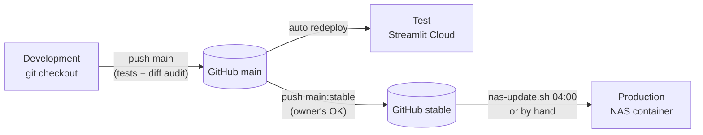

# Bresaola Tracker: setups

Status: **draft 1, 30 Oct 2026** (v0.4.22). Three environments run the same code with different settings.
This file says what each needs and how to check it works. The NAS step-by-step guide stays in
[`NAS.md`](NAS.md); this file is the overview and the reference for settings.

| | Development | Test | Production |
|---|---|---|---|
| Where | A development session (Claude's cloud workspace, or a PC) | Streamlit Community Cloud | Synology DS1019+ (DSM 7.4), Docker via Container Manager |
| Code from | Git checkout, any branch | `main`, redeployed on every push | `stable`, pulled nightly at 04:00 |
| Data | Throw-away `data/` folder | Demo data; wiped on every restart or sleep | Real: `docker/bresaola/data/`, backed up |
| `BRESAOLA_MODE` | unset (test) or `persistent` | unset (test) | `persistent` |
| Hub sync | Only on the home network | Not possible (can't reach the hub) | Yes: task every 6 hours |
| Who changes it | Developer | Automatic from `main` | Automatic from `stable`, after the owner's OK |



---

## 1. Settings reference

### 1.1 Environment variables of the app

| Variable | Default | Used by | Meaning |
|---|---|---|---|
| `BRESAOLA_MODE` | unset → test mode | `storage.is_test_mode` | `persistent`: real use, no banner, no demo data. Anything else: test mode with banner; a fresh database gets the demo batch and demo sensor readings. |
| `BRESAOLA_DATA` | `data` (relative to the working directory) | `storage` | Folder for `bresaola.sqlite` and `photos/`. `/data` in the container. |
| `BRESAOLA_TZ` | `Europe/Berlin` | `db.TZ` | Time zone for "today", "now" and the conversion of hub times. |
| `TZ` | system | OS, logs | Set to the same zone in the container, so log times match. |
| `BRESAOLA_EQUALISE` | unset | `db.close_problems` | `1`: an Equalise stage that was started must be locked before closing. The Equalise step has no screen (backlog); database code and tests exist. |
| `TAPO_USERNAME` | — | `tapo_sync` | Tapo (TP-Link) account e-mail. |
| `TAPO_PASSWORD` | — | `tapo_sync` | Tapo account password. |
| `TAPO_HUB_IP` | — | `tapo_sync` | The hub's address on the home network; fix it with a DHCP reservation. |
| `TAPO_SENSORS` | — | `tapo_sync` | Legacy (before v0.4.17): `<chamber name>=<sensor name>; …`. New setups set the sensor name per batch in the app. |

The hub sync is offered (button and task) only when the first three `TAPO_*` variables are all set
(`tapo_sync.is_configured`).

### 1.2 Settings of the update script (`scripts/nas-update.sh`)

Environment variables with defaults; normally none needs to be set.

| Variable | Default | Meaning |
|---|---|---|
| `BRANCH` | `stable` | Branch the NAS follows |
| `PORT` | `8520` | Port for the health check |
| `REPO` | `git@github.com:IamRepository/Bresaola.git` | Remote (SSH) |
| `KEY` | `/root/.ssh/bresaola_deploy` | Private deploy key (read-only on GitHub) |
| `WAIT` | `30` | Health-check attempts, 10 s apart |

### 1.3 Files that exist only in one environment

| File | Where | In git | In the image | Content |
|---|---|---|---|---|
| `.env` | NAS: `docker/bresaola/` | no (`.gitignore`) | no (`.dockerignore`) | `TAPO_*` credentials |
| `/root/.ssh/bresaola_deploy` | NAS, root's home | no | no | Private deploy key |
| `update.log`, `update.failed` | NAS: `docker/bresaola/` | no | no | Update history; marker of a bad commit |
| `data/` | every environment | no | no | Database, photos, safety copies |

The image is built from the repository with `tests/`, `scripts/`, `.git/`, `data/` and the files above excluded
(`.dockerignore`).

---

## 2. Development

### 2.1 Requirements

- Python 3.12 or newer (the image uses 3.12; development sessions have run 3.12 and 3.13).
- `pip install -r requirements.txt`. Add `-r requirements-local.txt` for the hub library (`tapo`), which is
  only needed to work on the hub sync against a real hub.
- For browser checks: Playwright with Chromium (`pip install playwright && playwright install chromium`;
  pre-installed in Claude's workspace).
- For the diagrams in `docs/`: Mermaid CLI (`mmdc`) to check they render, optional.

### 2.2 Run and test

```sh
streamlit run app.py                      # http://localhost:8501, test mode, demo data in a fresh data/
BRESAOLA_DATA=/tmp/b BRESAOLA_MODE=persistent streamlit run app.py   # empty, no demo
python -m pytest -q                       # ~300 tests, ~2 minutes
python -m pytest -q tests/test_calc.py    # one file
```

The test suite needs no network and no hub: the hub, Docker and curl are replaced by fakes.

### 2.3 Rules for a change set (from `CLAUDE.md`)

1. Change the code; every bug fix gets a test that fails without the fix (check by running it against the
   old code).
2. Visible change: check in a browser at 1280 px and 390 px.
3. Version bump in `bresaola/__init__.py` **and** the image tag in `compose.yaml` (`tests/test_deploy.py`
   fails otherwise).
4. Update the docs in the same change set if the change alters how the system works.
5. Full test suite, commit, push to `main`.
6. Diff audit; fix High and Medium findings with tests; record it in `CLAUDE.md`.
7. Owner's OK → `git push origin main:stable`.

### 2.4 Working on the hub sync

The hub is only reachable from the home network. Options, in order of convenience:

- On the NAS, inside the running container: `docker exec bresaola python -m bresaola.tapo_sync` (uses `.env`).
- A one-off DSM task with a test script (used on 29 Oct 2026 to find the H200's connection; see
  `DECISIONS.md`, D-14).
- A development session on a PC at home, with the three `TAPO_*` variables set in that shell.

Never more than one login attempt per test when a login is failing: the hub locks after repeated wrong
passwords.

---

## 3. Test: Streamlit Community Cloud

| Item | Value |
|---|---|
| App | private, deployed from the GitHub repository, main file `app.py` |
| Branch | `main` (every push redeploys) |
| Python packages | `requirements.txt` only (no `tapo`) |
| Mode | test (`BRESAOLA_MODE` not set) |
| Data | demo batch with 18 days of made-up sensor readings, a door-open hour and a left-out period; lost on restart or sleep |
| Secrets | none needed |

Use it to try a change on a phone before it reaches the NAS. It can't reach the hub, so the hub sync section
doesn't appear. To start fresh, reboot the app in the Streamlit Cloud dashboard. Anything worth keeping:
**Download backup** first, since it's gone after the next restart.

---

## 4. Production: the NAS

The step-by-step guide is [`NAS.md`](NAS.md). Its state on the owner's NAS, 30 Oct 2026:

| Item | Value |
|---|---|
| Address | `http://192.168.15.130:8520`; from outside through VPN Plus on the Synology router |
| Folder | `/volume1/docker/bresaola`: a git checkout of `stable` |
| Container | `bresaola`, image `bresaola-tracker:<version>`, `network_mode: host`, port 8520 (MailPlus blocks 8500–8507) |
| Data | `docker/bresaola/data` → `/data` |
| `.env` | `TAPO_USERNAME`, `TAPO_PASSWORD`, `TAPO_HUB_IP=192.168.15.197` |
| Hub | Tapo H200 (reports as `CameraHub`), firmware 1.7.7, DHCP reservation 192.168.15.197; only the encrypted connection, port 80 closed |
| Sensors on the hub | T315 "Fridge, garage" (Palermo and Rome), T315 "Garasje", T300 "Water Leak Sensor" |

### 4.1 Scheduled tasks (DSM Task Scheduler, all as root)

| Task | Schedule | Script | E-mail |
|---|---|---|---|
| `bresaola-update` | daily 04:00 | `sh /volume1/docker/bresaola/scripts/nas-update.sh` | only on failure |
| `tapo_to_nas` | daily 00:00, repeat every 6 h until 18:00 | `docker exec bresaola python -m bresaola.tapo_sync` | only on failure (recommended) |
| `bresaola-setup` | disabled, by hand once | `sh …/nas-update.sh setup` | — |
| Hyper Backup | 02:30 | (DSM) | DSM default |

Why every 6 hours: the hub keeps 24 hours and loses them on a restart. With a run every 6 hours, three runs
in a row can fail before a reading is lost.

### 4.2 Checks

```sh
docker exec bresaola sh -c 'echo "hub=$TAPO_HUB_IP user_set=${TAPO_USERNAME:+yes} pw_set=${TAPO_PASSWORD:+yes}"'
docker exec bresaola python -c "import bresaola; print(bresaola.__version__)"
docker exec bresaola pip show tapo | grep Version
docker exec bresaola python -m bresaola.tapo_sync
tail -5 /volume1/docker/bresaola/update.log
```

In the app: the version under the title; in each drying batch, "Last loaded from the hub" under Sensor
readings.

### 4.3 When `.env` changes

The container reads `.env` only when it is created. After editing it: Container Manager → project
**bresaola** → **Stop** → **Build**, or
`cd /volume1/docker/bresaola && docker compose -p bresaola up -d --force-recreate`.
The nightly update also recreates the container, but only when there is a new version.

---

## 5. Moving or rebuilding production

1. In the old app: **Download backup** (database + photos as one zip). Or copy `data/` as it is.
2. Install on the new host as in `NAS.md` sections 1–2; copy `.env` across by hand (it isn't in git).
3. Restore the backup in the new app, or put the copied `data/` in place before the first start.
4. Set up the deploy key and the tasks again (`NAS.md` sections 6 and 8); the deploy key is per host.
5. Check as in 4.2.
